<picture>
  <source media="(prefers-color-scheme: dark)" srcset="skyline-dark.svg">
  
</picture>

Security labs and write-ups (network scans, packet captures, log analysis, rootkits) at [Securus Journal](https://securus.pages.dev).
