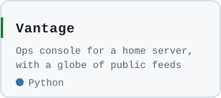
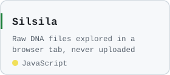
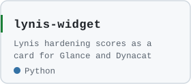
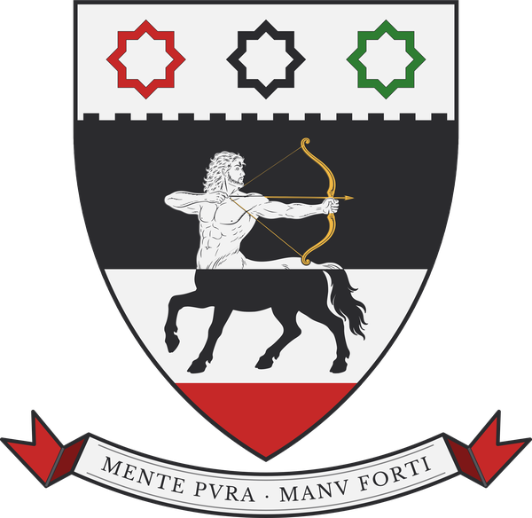

<picture>
  <source media="(prefers-color-scheme: dark)" srcset="header-dark.svg">
  
</picture>

  <a href="https://linktr.ee/800zjs"><picture>
    <source media="(prefers-color-scheme: dark)" srcset="link-dark.svg">
    
  </picture></a>

### Projects

  <a href="https://github.com/zakijss/Vantage"><picture>
    <source media="(prefers-color-scheme: dark)" srcset="card-vantage-dark.svg">
    
  </picture></a>
  <a href="https://github.com/zakijss/Silsila"><picture>
    <source media="(prefers-color-scheme: dark)" srcset="card-silsila-dark.svg">
    
  </picture></a>
  <a href="https://github.com/zakijss/lynis-widget"><picture>
    <source media="(prefers-color-scheme: dark)" srcset="card-lynis-widget-dark.svg">
    
  </picture></a>

### Activity

<picture>
  <source media="(prefers-color-scheme: dark)" srcset="https://raw.githubusercontent.com/zakijss/zakijss/output/skyline-dark.svg">
  
</picture>

  <picture>
    <source media="(prefers-color-scheme: dark)" srcset="divider-dark.svg">
    
  </picture>

  

<i>Argent, a fess embattled sable, a base gules, over all a sagittary counterchanged, turned to shoot to sinister, the bow and arrow or; in chief three mullets of eight points voided gules, sable and vert.</i>

<b>Mente pura, manu forti</b>: with a pure mind, with a strong hand.

